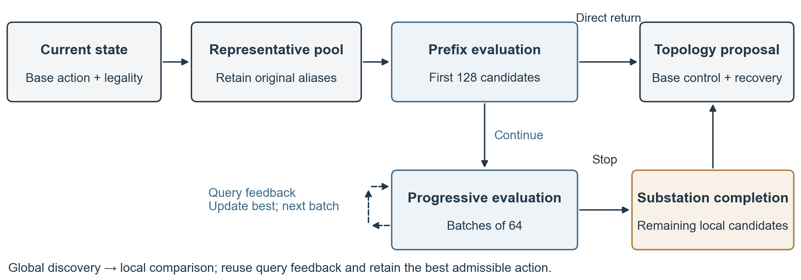

# Progressive Topology Search with Substation Completion for Power Grid Control

## Abstract

Online power grid controllers compare topology actions through predictive simulation, making candidate evaluation a direct contributor to control overhead. Global rankings interleave different configurations of the same substation, so early stopping can miss high-quality configurations within an already identified substation and increase subsequent operating costs. We propose FRAME, a progressive topology search framework that combines batched evaluation with substation completion. FRAME expands a ranked prefix using observed feedback and, after expansion stops, evaluates the remaining configurations of the substation associated with the current best candidate. Local completion helps maintain control quality while using substantially fewer candidate evaluations. On four development dates in Grid2Op, FRAME reduces candidate queries by 69.37% and controller time by 13.11% relative to exhaustive search; completion reduces the worst full-week cost increase from 4.810% to 0.372%. On three separately frozen confirmation dates, FRAME matches the survival outcomes of exhaustive search and reduces controller time by 6.09%. Queries decrease by an average of 83.54% over the two dates with active search, while the largest full-week cost increase is 0.014%. These results show that allocating additional evaluations according to the structural membership of actions can improve control quality while retaining most of the search savings.

Keywords: power grid topology control; online search; computational allocation; substation completion

## 1 Introduction

Power grid topology control relieves congestion by changing how lines, generators, and loads connect to busbars. Online controllers coordinate these topology changes with redispatch, curtailment, storage, and recovery as demand and generation evolve. Predictive simulation allows controllers to inspect the consequences of candidate actions before execution, while adding computational overhead for each evaluation. Grid2Op provides a public experimental environment for this sequential decision process [1]. Obtaining high-quality actions with fewer evaluations is therefore central to improving online control efficiency.

Existing methods improve action selection through hybrid control and learned rankings. The LJN agent combines continuous optimization with discrete topology search [2]. SoftGNN and related graph learning methods use grid structure to rank actions and then validate candidates through simulation [3,4]. Prioritizing promising actions helps controllers find useful solutions early in the search. As candidate pools grow, controllers must also decide when to stop evaluating and which actions deserve further comparison before returning a decision.

Global rankings and the structural grouping of topology actions have a specific mismatch: configurations of the same substation may be far apart in the ranked sequence. Once search identifies a useful substation, that substation may still contain unqueried effective configurations even when several subsequent candidates bring no reward improvement. Stopping at this point can miss a better configuration later in the sequence, whereas traversing the entire pool adds many evaluations at other substations. This mismatch creates an opportunity to allocate the remaining computation using action structure.

We propose FRAME, which combines progressive prefix search with completion of the substation associated with the current best candidate. Prefix search quickly identifies admissible actions and determines how far to expand using reward improvements and predicted loading ratios. After expansion stops, substation completion concentrates evaluation on the remaining configurations of the identified structural unit. The two stages form a search process that proceeds from global discovery to local comparison. A common interface connects this process to a hybrid controller, and the candidate ranking component can be replaced according to application needs.

Our contributions are threefold. First, we introduce a topology search framework that combines progressive stopping with substation completion, directing limited evaluations toward a currently promising configuration group. Second, we construct completion sets that retain aliases of physically equivalent actions, preserving their original substation membership after canonicalization and retaining the best observed selection result during completion. Third, closed-loop comparisons, ablation experiments, and step-level case analysis demonstrate the framework's quality and computational benefits. Development experiments reduce queries by approximately 70% while limiting the largest full-week cost increase from early stopping to 0.372%; frozen dates further retain query and controller-time savings relative to exhaustive search.

## 2 Method

### 2.1 Framework Overview

FRAME first uses a ranking to locate promising actions, then uses substation structure to complete their local comparison. Figure 1 illustrates the pipeline. The controller generates currently available topology candidates and merges physically equivalent actions into representatives. The search layer evaluates a ranked prefix and expands it in batches using the returned feedback. When expansion reaches a stopping condition, it completes the substation associated with the current best candidate and returns the selected topology proposal to the base controller. The base controller continues to manage continuous control and recovery.

The two search stages serve complementary purposes. Progressive evaluation limits global search effort and avoids traversing the entire pool at every decision. Structural completion uses the membership of an identified candidate to check configurations of the same substation that are dispersed in the global ranking. The ranking component supplies the priority order, while the search layer determines the actual query set.

Figure 1. Progressive search with substation completion.

### 2.2 Problem Formulation

At decision time t, the controller receives the current observation x and a base continuous action b. Let I denote the original topology action library, where each action has an identifier i and a substation label s(i). The system filters actions using legality and cooldown constraints, handles disconnected endpoints, and combines each topology intervention with b. Candidates that yield the same physical action vector in the current state share a canonical representative. Let rep(i) map an original action to its representative, and let A denote the ordered representative set. All original aliases and their substation labels are retained.

A query Q(x,b,a) performs predictive simulation for candidate a and returns reward r(a), maximum line loading ratio ρ(a), and termination, exception, and legality flags. FRAME selects subsequent candidates using the current observation, fixed action metadata, and feedback from queries already executed. To retain the base controller's filtering requirements, we call a candidate admissible when it passes the legality checks and satisfies

\[
0 < \rho(a) < \min\{\rho(x),\theta\}
\]

Here, ρ(x) is the current maximum line loading ratio and θ is the threshold supplied by the base controller. The legality checks require that the predicted transition does not terminate and contains no exception, illegal action, or ambiguous action. We compare admissible actions using the following selection key:

\[
f(a)=(\operatorname{fp32}(r(a)),-i(a))
\]

This key prioritizes higher predicted rewards and breaks reward ties in favor of smaller identifiers. The fp32 operation converts the reward to single precision, and i(a) is the identifier retained by the representative. Both follow the base implementation. The search layer returns the best admissible topology proposal; when no candidate is admissible, the base controller executes its existing fallback procedure.

### 2.3 Progressive Candidate Evaluation

Progressive evaluation starts by querying the first min(128,|A|) representatives and identifying the current best candidate. It returns directly if the pool is exhausted or the best candidate has a predicted loading ratio below 0.9. This prefix provides a concentrated initial comparison and enables easier states to reach a decision early.

For the remaining states, evaluation continues in batches of up to 64 candidates. After each batch, the search updates its best selection key. An improvement resets the consecutive non-improving batch counter; otherwise, the counter increases by one. Global expansion stops when the best candidate has a predicted loading ratio below 0.9, or when at least 256 queries have been made and two consecutive batches produce no improvement. If no admissible candidate is found, search continues until the pool is exhausted.

The loading condition identifies states with a sufficiently favorable prediction, while the consecutive non-improvement condition limits additional computation on a reward plateau. The next stage concentrates on unqueried configurations of the same substation among the candidates left after stopping.

### 2.4 Structural Completion of a Substation

Structural completion addresses configurations of the same substation that are dispersed in the global ranking. Let C be the set of representatives queried at the end of expansion, let a_C be its best admissible candidate, and let s_C=s(i(a_C)) identify the selected substation. The set of representatives to be queried during completion is

\[
L=\{\operatorname{rep}(i)\in A\setminus C:s(i)=s_C\}
\]

Membership is determined through original aliases: a representative enters L whenever any of its original aliases belongs to s_C. Physical equivalence merging thus reduces duplicate evaluations while retaining the structural relationships. FRAME queries each representative in L and returns the admissible candidate with the largest selection key in C∪L.

Completion uses the substation selected at the end of expansion and performs one pass. It is triggered after expansion when a best candidate exists and unqueried candidates remain. The branch that returns directly from the initial prefix retains its low overhead. Algorithm 1 gives the full procedure.

Algorithm 1. Progressive Search with Substation Completion

Input: ordered representative pool A; query interface Q; alias map and substation labels s

C ← query the first min(128, |A|) representatives

a ← best admissible candidate in C

If C exhausts A, or a exists and ρ(a) < 0.9, return a

stale ← 0

While unqueried candidates remain:

    Query the next batch of at most 64 representatives; update C and a

    Reset stale on a selection-key improvement; otherwise increment stale

    If a exists and [ρ(a) < 0.9 or (query count ≥ 256 and stale ≥ 2)]:

        End the expansion loop

If a exists and C does not exhaust A:

    s_C ← original substation of a

    L ← unqueried representatives with an alias belonging to s_C

    Query L once; update a using the same admissibility rule and selection key

Return a; if no candidate is admissible, use the base controller fallback

### 2.5 Completion Property and Query Overhead

Completion retains the best feedback already obtained and adds comparisons with local candidates. If a_C and a_after denote the best candidates before and after completion, respectively, then f(a_after)≥f(a_C). The previous incumbent a_C remains in C∪L, and an update accepts only a larger selection key. Completion adds |L| queries. Query bookkeeping ensures that each canonical representative is evaluated at most once, so the total number of queries is bounded by |A|.

This property gives local completion a clear direction of benefit and an explicit computational account: the best observed selection is retained, and new evaluations concentrate on the selected substation. The next section evaluates its effects on multi-step operation through closed-loop experiments.

## 3 Experiments

### 3.1 Experimental Setup

We use the public l2rpn_idf_2023 environment, LightSim2Grid, and a hybrid controller based on LJN [1,2]. The original topology library contains 909 actions; legality filtering and equivalence merging produce the current candidate pool. All four methods share the author-frequency ranking, continuous control, recovery policy, prediction interface, and DC/safe-QP compilation caches. The comparison focuses on search stopping and structural completion.

| Policy | Search behavior |

| --- | --- |

| FULL | Evaluate all legal canonical representatives and return the admissible candidate with the largest selection key. |

| FIRST_SAFE_BEST | Return the first admissible prediction with ρ<0.9; if the pool is exhausted, retain the best admissible candidate. |

| NO_LOCAL | Use FRAME's prefix, batches, and stopping rules, with structural completion disabled. |

| FRAME | Perform progressive evaluation followed by conditional substation completion. |

FULL provides an exhaustive candidate search reference. FIRST_SAFE_BEST returns at the first candidate that meets the loading threshold and retains the best admissible action if the pool is exhausted. NO_LOCAL tests the role of structural completion. The shared ordering uses the frequency prior, with the same order in all main experiments.

The experiments comprise development and confirmation sets. Development uses four dates: 2035-03-05_0, 2035-06-25_8, 2035-09-03_4, and 2035-10-01_5, yielding 32 runs. Confirmation uses three date variants that were previously excluded from local development: 2035-04-09_3, 2035-05-14_14, and 2035-11-19_0, yielding 24 runs. A fixed metadata rule selects the confirmation dates, and the policies, thresholds, and execution order are frozen before replay. Each set evaluates four methods with two balanced serial repetitions per date.

Experiments run on an AMD Ryzen 9 8940HX machine with Windows 11. Software versions are Python 3.12.14, Grid2Op 1.12.5, LightSim2Grid 1.1.0, CVXPY 1.9.3, Clarabel 0.11.1, and OSQP 1.1.3. Replay uses one serial CPU worker with numerical libraries restricted to a single thread.

### 3.2 Evaluation Metrics

We measure candidate queries, actual controller time, full-week operating cost, and survival steps. Controller time includes search preparation, ranking, predictive simulation, and continuous control; environment stepping, initialization, and result saving are recorded separately. Let T_m,d,j denote controller time for method m on date d in repetition j. We first average the repetitions within each date:

\[
\bar T_{m,d}=\tfrac12(T_{m,d,0}+T_{m,d,1})
\]

We then compute savings relative to FULL for each date and take an equally weighted average:

\[
S_T(m)=\tfrac1{|D_T|}\sum_{d\in D_T}(1-\bar T_{m,d}/\bar T_{\mathrm{FULL},d})
\]

D_T contains comparisons with equal run lengths. Query savings use the same aggregation, with FULL's query count as the denominator; zero-query dates are listed separately. The full-week cost change is (J_m,d−J_FULL,d)/J_FULL,d, where a positive value indicates an increase. It is computed when both methods complete the week. Costs follow L2RPNSandBoxScore and comprise a weighted sum of energy losses, absolute redispatch energy, changes in curtailment energy, and storage throughput energy.

The quality criterion is fixed before execution: no earlier failure than FULL and at most a 0.5% cost increase on comparable full weeks. The confirmation experiment additionally requires at least two comparable completed dates, average controller-time savings of at least 5%, and positive time savings on at least two dates. All results are aggregated by date.

### 3.3 Overall Quality and Computational Benefits

Table 1 shows how the four search policies maintain control quality and reduce evaluation effort. FRAME passes the quality criterion on every date in both sets and reduces candidate queries and controller time relative to FULL. Development query savings reach 69.37%, with controller-time savings of 13.11%. In confirmation, queries decrease by 83.54% on average over the two dates with active search, while controller time decreases by 6.09% over all three dates. Continuous control remains part of the decision loop, so the reduction in total controller time is smaller than the reduction in candidate queries.

Table 1. Quality and computational results aggregated by date.

| Set | Policy | Dates passing quality | Full weeks | Controller time savings | Query savings | Worst full-week cost change |

| --- | --- | --- | --- | --- | --- | --- |

| Development | FULL | 4/4 | 3/4 | 0.00% | 0.00% | 0.000% |

| Development | FIRST_SAFE_BEST | 2/4 | 3/4 | 7.06% | 51.45% | +3.952% |

| Development | NO_LOCAL | 3/4 | 3/4 | 14.26% | 71.84% | +4.810% |

| Development | FRAME | 4/4 | 3/4 | 13.11% | 69.37% | +0.372% |

| Confirmation | FULL | 3/3 | 2/3 | 0.00% | 0.00% | 0.000% |

| Confirmation | FIRST_SAFE_BEST | 3/3 | 2/3 | -7.75% | 89.24% | -0.218% |

| Confirmation | NO_LOCAL | 3/3 | 2/3 | 9.38% | 84.02% | +0.014% |

| Confirmation | FRAME | 3/3 | 2/3 | 6.09% | 83.54% | +0.014% |

Development results show that FRAME retains most of NO_LOCAL's computational savings while improving its cost tail. Adding completion reduces the worst full-week cost increase from 4.810% to 0.372%, while controller-time savings change from 14.26% to 13.11%. A targeted set of additional evaluations therefore repairs the quality loss caused by early stopping in this matrix.

Table 2 lists all confirmation dates. Full-week cost decreases by 1.328% relative to FULL in April and increases by 0.014% in November. Query counts decrease from 5445 to 1012 and from 2680 to 384, respectively. FRAME meets the quality criterion on both full weeks. All four policies terminate at step 747 in May, with no topology search calls during that run. Development also contains a shared early termination in June, where all methods reach step 1901.

Table 2. All frozen confirmation dates for FRAME.

| Confirmation date | FRAME steps and outcome | Full-week cost change | Controller time savings | Queries FULL → FRAME |

| --- | --- | --- | --- | --- |

| April 9 | 2017 steps, completed | -1.328% | 4.080% | 5445 → 1012 |

| May 14 | 747 steps, failed | Not comparable | 1.758% | 0 → 0 |

| November 19 | 2017 steps, completed | +0.014% | 12.419% | 2680 → 384 |

### 3.4 The Role of Structural Completion

Removing completion has its clearest effect on the March development date. NO_LOCAL's full-week cost exceeds FULL by 4.810%, and FRAME reduces this difference to 0.372%. At step 1733, NO_LOCAL stops after querying 256 candidates and selects action 26. FRAME then evaluates 198 additional candidates at the selected substation and chooses action 309, matching FULL's choice after evaluating 909 actions. With 454 queries at this step, FRAME recovers an effective configuration missed by the ranked prefix.

This case illustrates how structural completion works: the global prefix locates a useful substation, and local queries complete the configuration comparison. Completion changes the selected action in 12 of the 90 FRAME calls examined in the saved-state checks. Closed-loop ablation and step-level records together support the design of further evaluation around an identified structural unit.

Completion benefits vary with the state. On the April confirmation date, FRAME's cost improvement over NO_LOCAL is 0.00782% of FULL's cost. Completion is not triggered in November, and the two methods have identical physical trajectories and costs. Computationally, FRAME's time savings relative to FULL are 1.15 percentage points lower than NO_LOCAL's in development and 3.30 points lower in confirmation, reflecting the extra work required for local comparison.

### 3.5 Stopping Policies and Timing Behavior

FIRST_SAFE_BEST returns earlier and performs fewer queries. It passes the quality criterion on 2/4 development dates and 3/3 confirmation dates, showing that the first threshold-satisfying action can already be effective in some scenarios. FRAME passes on 4/4 development dates and retains 3/3 in confirmation, reflecting the quality outcomes associated with more extensive comparison.

FIRST_SAFE_BEST's all-date timing average in confirmation is affected by variation on the zero-search date. To interpret this behavior, we additionally report descriptive statistics for the two dates with active search: controller-time savings are 11.92% for FIRST_SAFE_BEST and 8.25% for FRAME. These results identify the evaluation workload associated with earlier stopping and structural completion.

Repeated runs of the same method produce identical physical trajectories, while wall-clock time still varies. For example, FRAME's two controller times in April are 76.28 and 44.73 seconds; FIRST_SAFE_BEST's times in May are 13.43 and 6.84 seconds. The main table retains both repetitions using the predefined aggregation. Query counts capture search effort, and controller time captures the overall overhead of the current implementation on the experimental machine. Together, they characterize efficiency.

## 4 Conclusion

We introduce progressive topology search with substation completion, combining global prefix evaluation with local configuration comparison. The framework uses query feedback to control expansion and, after expansion stops, evaluates the remaining configurations of the substation associated with the best candidate. This process substantially reduces candidate evaluation while maintaining control quality in the evaluated runs. Development experiments reduce queries by 69.37% and controller time by 13.11% relative to exhaustive search, while reducing the maximum full-week cost increase of the policy without completion from 4.810% to 0.372%. Frozen-date experiments retain query and time savings. The results provide a search procedure that can be integrated into existing hybrid power grid controllers and demonstrate the role of action structure in allocating evaluation effort.

## 5 Related Work

### 5.1 Hybrid Grid Control and Learned Rankings

Hybrid control combines continuous optimization with discrete topology decisions. The public LJN agent provides the base controller and action library used here [2]. Learned rankings further exploit grid states and structure to prioritize candidates. SoftGNN uses soft labels to learn preferences among multiple effective topology actions and validates candidates through predictive simulation [3]. De Jong et al. study graph neural network generalization under topology changes and its integration with validation search [4]. FRAME organizes evaluations after ranking, incorporating progressive expansion and same-substation completion into this control process. A ranking model can serve as an auxiliary component.

### 5.2 Computational Allocation during Search

Metareasoning in planning studies decisions about the benefits and costs of computation. Bhatia et al. use deep reinforcement learning to adjust hyperparameters and the computational process of anytime planning [5], while bounded-optimal metareasoning incorporates deliberation costs into policy evaluation [6]. We allocate single-step simulations using a structural heuristic: the global stage uses observed improvements to determine expansion, and the local stage uses the substation membership of the best candidate to determine what to query next. This connects the stopping decision to the subsequent evaluation set.

### 5.3 Structural Neighborhood Comparison

Inspecting related alternatives around a current solution is a basic idea of neighborhood search. FRAME instantiates this idea as a substation completion set in the current action space. Original action aliases participate in set construction, preserving structural membership after physical equivalence merging. Completion runs after expansion stops and reuses existing feedback. This organization concentrates additional queries on the selected configuration group; NO_LOCAL ablation and step-level action records examine its role.

## 6 Limitations

The current closed-loop experiments cover one grid, four development dates, and three confirmation dates. Additional dates and grids would help assess parameter adaptability. Confirmation dates are excluded from local training and tuning, while the original teacher-date coverage of the external frequency prior remains to be established. The larger cost benefit from local completion is concentrated in one development date, and FIRST_SAFE_BEST is also competitive in confirmation.

Wall-clock results are affected by run-to-run variation. We report measured means over two repetitions; timing differences on the zero-search date arise from other parts of the control loop. More stable timing repetitions would help quantify overall acceleration further. Simulation operating costs follow the benchmark accounting scheme, and practical deployment requires validation against operating rules and independent safety assessment.

The completion property concerns the best selection key within a single query set. Long-term costs and survival are assessed through closed-loop runs, and worst-case query counts can reach the full candidate pool. Existing checks use saved states, feedback, and cost vectors. Independent AC power-flow recomputation and cross-platform reproduction provide directions for further validation.

## References

[1] RTE France. Grid2Op: A testbed for sequential decision making in power systems. Official software; installed version 1.12.5. https://github.com/rte-france/Grid2Op.

[2] Lajavaness. 2023. L2RPN 2023 LJN Agent. Official source implementation. https://github.com/lajavaness/l2rpn-2023-ljn-agent.

[3] Hassouna, M.; Holzhüter, C.; Lehna, M.; de Jong, M.; Viebahn, J.; Sick, B.; and Scholz, C. 2025. Learning Topology Actions for Power Grid Control: A Graph-Based Soft-Label Imitation Learning Approach. In Machine Learning and Knowledge Discovery in Databases. Applied Data Science Track and Demo Track, volume 16022, 129--146. DOI: 10.1007/978-3-032-06129-4_8.

[4] de Jong, M.; Viebahn, J.; and Shapovalova, Y. 2025. Generalizable Graph Neural Networks for Robust Power Grid Topology Control. arXiv:2501.07186v1.

[5] Bhatia, A.; Svegliato, J.; Nashed, S. B.; and Zilberstein, S. 2022. Tuning the Hyperparameters of Anytime Planning: A Metareasoning Approach with Deep Reinforcement Learning. Proceedings of ICAPS 32:556--564. DOI: 10.1609/icaps.v32i1.19842.

[6] Milli, S.; Lieder, F.; and Griffiths, T. 2017. When Does Bounded-Optimal Metareasoning Favor Few Cognitive Systems? Proceedings of AAAI 31. DOI: 10.1609/aaai.v31i1.11156.
