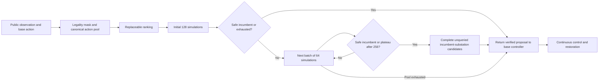

# Framework diagram source

If no admissible incumbent exists, the extended search continues to exhaustion. Structural completion is conditional on extended-search stopping with an incumbent and remaining candidates. The diagram does not claim a hard runtime limit or future safety guarantee.

GNN is one possible ranker, not a necessary node in the main framework.
